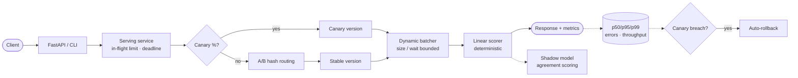

# Model Serving at Scale

A **production model-serving layer**: dynamic **request batching**
(max size / max wait), **canary releases** with traffic splitting and
**auto-rollback** on error/latency breach, **shadow mode** with
agreement scoring, deterministic **A/B variant routing**, a **model
version registry**, **latency percentiles + throughput metrics**,
**deadline handling**, and **load-shedding** — behind a FastAPI
service, a CLI, and an offline demo.

Everything runs **offline** on **deterministic fake models** (a linear
scorer through a sigmoid) with the Python standard library alone —
FastAPI is an optional extra. All code is original, data is synthetic,
and routing is hash-deterministic, so demos and tests are reproducible.

## The problem

Serving a model at scale is not "wrap it in an endpoint":

1. **One request at a time wastes the hardware.** Inference has a
   fixed per-call cost; batching amortises it — but waiting to fill a
   batch trades latency for throughput, and that trade-off must be
   bounded on both sides (max size AND max wait).
2. **Every release is a risk.** Shipping a new version to 100% of
   traffic at once turns a bad model into an outage. Canary traffic
   with automatic rollback on error-rate / latency breach contains it.
3. **Offline metrics lie politely.** A candidate that wins offline
   can still disagree with production on live inputs. Shadow mode
   measures that disagreement before the candidate serves anyone.
4. **Experiments need sticky assignment.** Random per-request A/B
   routing contaminates experiments; the same user must always see
   the same variant — without server-side state.
5. **Overload must shed, not queue forever.** Unbounded queues turn a
   traffic spike into cascading timeouts. Shedding early with a 503
   keeps the requests that are served within their deadlines.

## Architecture



Full design notes: [docs/architecture.md](docs/architecture.md).

## Quickstart

Requires Python 3.11+. The core has **zero dependencies**.

```bash
pip install -e .            # core (stdlib only)
pip install -e ".[api]"     # + FastAPI/uvicorn for the HTTP API
pip install -e ".[dev]"     # + pytest for the test suite

python examples/run_demo.py
# equivalently: model-serving demo
```

Demo output (abridged):

```
registry: ['churn', 'fraud'] churn versions=['v1', 'v2'] active=v1
single: score=0.7311 label=1 version=v1 variant=stable
batching: 3 requests -> batches_executed=1 items=3 batch_sizes=[3, 3, 3]
canary: ... rolled_back=True reason=error rate 0.333 > 0.1
shadow: {'total': 4, 'agreement_rate': ..., 'mean_abs_diff': ...}
demo OK
```

Use it as a library:

```python
from model_serving import build_demo_service, PredictRequest

service = build_demo_service()
resp = service.predict(PredictRequest("req-1", (0.9, 0.2, 0.7, 0.1), user_id="user-1"))
print(resp.score, resp.label, resp.model_version, resp.variant)
```

Run the serving API:

```bash
model-serving serve --port 8000
# GET  /health · GET /models · GET /metrics
# POST /predict  {"request_id": "...", "features": [...], "model_name": "churn"}
#   -> 503 when load-shed, 504 when the deadline is exceeded
```

Docker:

```bash
docker build -t model-serving-at-scale .
docker run -p 8000:8000 model-serving-at-scale
```

## Serving semantics

- **Batching**: flush at `max_batch_size` (default 8) or after
  `max_wait_ms` (default 20 ms), whichever comes first. A full queue
  sheds with `OverloadedError` instead of queueing unboundedly.
- **Canary**: `traffic_pct` of hashed traffic goes to the newest
  non-active version. After `min_requests`, an error rate above the
  threshold or a p95 above the latency budget triggers
  **auto-rollback** with the reason recorded.
- **Shadow**: the candidate scores every request off-path; label
  agreement rate and mean absolute score difference are reported.
  Shadow failures never affect the primary response.
- **A/B routing**: SHA-256 bucketing — sticky per user, stateless,
  weights in percent summing to 100.
- **Deadlines**: a request whose measured latency exceeds its
  `deadline_ms` raises `DeadlineExceededError` (HTTP 504) and counts
  as an error — a late score is treated as no score.
- **Load-shedding**: past `max_inflight` concurrent requests, new
  requests fail fast (HTTP 503) and increment the shed counter.

## Key design decisions & trade-offs

- **Deterministic fake models.** A linear scorer makes every serving
  behaviour — batching order, canary splits, shadow agreement —
  exactly reproducible in tests. A real artefact (ONNX, TorchScript,
  an LLM endpoint) drops behind the same `predict_batch` contract.
- **Canary and A/B use separate hash namespaces** so experiment
  assignment and release assignment stay independent.
- **No silent fallback for scored decisions.** Unlike a recommender,
  a scoring service must not substitute a different model's answer
  on failure — errors propagate and are counted. Degradation here is
  shedding + rollback, not substitution.
- **Exact percentiles over sketches** at this scale: the latency list
  is the honest implementation; the metrics seam is where a
  production system swaps in a streaming histogram.
- **Stdlib-first core.** Batching, routing, canary, shadow, and
  metrics use only `threading`/`queue`/`hashlib`; FastAPI is isolated
  behind a guarded import in `service.py`.

## What it demonstrates

- Inference-serving system design: dynamic batching, version
  registry with promote/rollback, canary + shadow release patterns.
- Experiment infrastructure: stateless sticky A/B assignment.
- Production judgement: deadlines, load-shedding, auto-rollback,
  percentile-based alerting metrics.
- Clean-room engineering: synthetic data, typed modules, 55+ tests.

## Testing

```bash
python -m pytest -q   # or: make test
```

The suite covers scorer determinism and validation, registry
promote/rollback/duplicates, batch chunking, batcher coalescing,
size-flush and error propagation, hash stability and A/B
distribution, canary routing/rollback (errors, latency, min-request
gate), shadow agreement/divergence, percentile maths, the end-to-end
service (stable, canary, A/B, batched, deadline, load-shed), the CLI,
the demo, and the HTTP API when the `api` extra is installed.

CI: [docs/github-actions-ci.yml](docs/github-actions-ci.yml) is a
ready-to-use GitHub Actions workflow (move it to
`.github/workflows/ci.yml` to activate).

## Limitations

- Models are deterministic linear scorers — the serving layer is the
  subject; model quality work slots behind its contract.
- The batcher is single-process; a production deployment shards
  batchers per replica and balances across them.
- The registry is in-memory; production registries persist artefacts
  and metadata — the promote/rollback semantics carry over unchanged.
- Percentiles are exact over all observed latencies (unbounded
  memory over a very long run) — a windowed histogram is the
  documented production swap.

## License

MIT — see [LICENSE](LICENSE).
