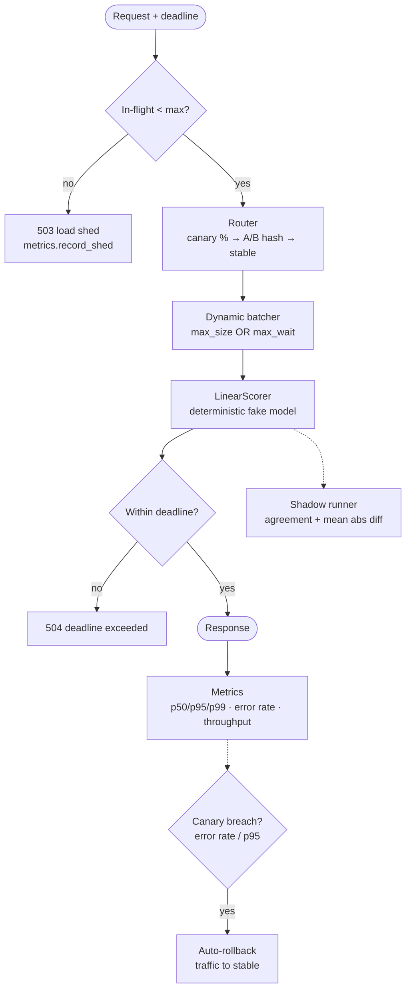

# Architecture — Model Serving at Scale

## Problem framing
A model in production is a distributed-systems problem: GPUs/CPUs are
expensive so requests must be batched, releases are risky so traffic
must be shifted gradually with automatic rollback, and a candidate
model must be validated on live inputs (shadow) before it serves a
single real decision. This build is a small, complete reference for
that serving layer, with deterministic fake models so every behaviour
is testable offline.

## Components

### Registry (`registry.py`)
Multiple versions per model, one active. `promote` moves the active
pointer; `rollback` walks the promotion history back. Duplicate
registrations are rejected — a version, once served, is immutable.

### Batcher (`batcher.py`)
A background thread drains a bounded queue, flushing when either
`max_batch_size` is reached or `max_wait_ms` elapses since the first
queued item — the classic latency/throughput trade-off made explicit.
A full queue raises `OverloadedError` (the load-shedding signal)
instead of growing latency unboundedly. `collect_batch` is the pure
chunking helper.

### Router (`router.py`)
`hash_bucket` = first 8 hex chars of SHA-256 mod 100. The same user
always lands in the same bucket, so A/B assignment is sticky without
any server-side state. Variants carry percent weights summing to 100.

### Canary (`canary.py`)
A separate hash namespace (`canary:<key>`) splits traffic so canary
assignment is independent of A/B assignment. The controller tracks
its own error rate and p95; `evaluate()` rolls back (traffic → 0,
reason recorded) when either breaches its threshold after
`min_requests`. A rolled-back canary cannot be promoted.

### Shadow (`shadow.py`)
Every shadowed request is scored by primary and candidate. Agreement
is label agreement; `mean_abs_diff` tracks score drift even when
labels agree. Shadow failures never affect the primary response —
the shadow score is NaN and counted as a divergence.

### Metrics (`metrics.py`)
Lock-guarded latency list with exact percentile interpolation,
error rate, batch statistics, shed count, and throughput over a
caller-supplied elapsed window. Exact (not sketched) percentiles are
the right call at this scale; the seam is where a HDR histogram or
Prometheus client would slot in.

### Service (`service.py`)
`ModelServingService.predict` acquires an in-flight slot (shedding
past `max_inflight`), resolves version/variant (canary → A/B →
stable), optionally goes through a batcher, enforces the per-request
deadline, runs the shadow, records canary + global metrics, and
always releases the slot. FastAPI (`create_app`) is a guarded import:
`/health`, `/models`, `/metrics`, `/predict` (503 on shed, 504 on
deadline).

## Failure modes

| Failure | Behaviour |
|---|---|
| Queue / in-flight full | `OverloadedError` → HTTP 503, shed counted |
| Deadline exceeded | `DeadlineExceededError` → HTTP 504, counted as error |
| Model raises | Error metric recorded; exception propagates (no silent fallback — a wrong score is worse than an error for scored decisions) |
| Canary errors / slow | Auto-rollback, reason recorded, traffic returns to stable |
| Shadow model raises | Primary unaffected; divergence recorded |
| Unknown model/version | `ModelNotFoundError` |
| FastAPI missing | Core works; `create_app()` raises install hint |

## Extension points
- Real model artefacts behind `LinearScorer.predict_batch`'s contract.
- GPU-aware batch sizing / continuous batching for LLM serving.
- Prometheus/OpenTelemetry exporters behind `MetricsRegistry.snapshot`.
- Persistent registry (object store + metadata DB) behind `ModelRegistry`.
